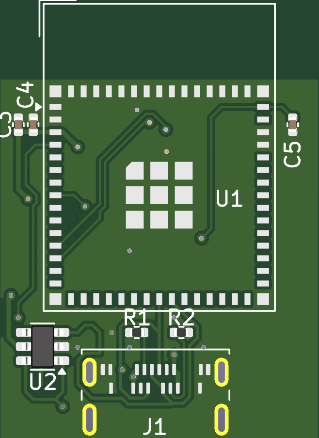
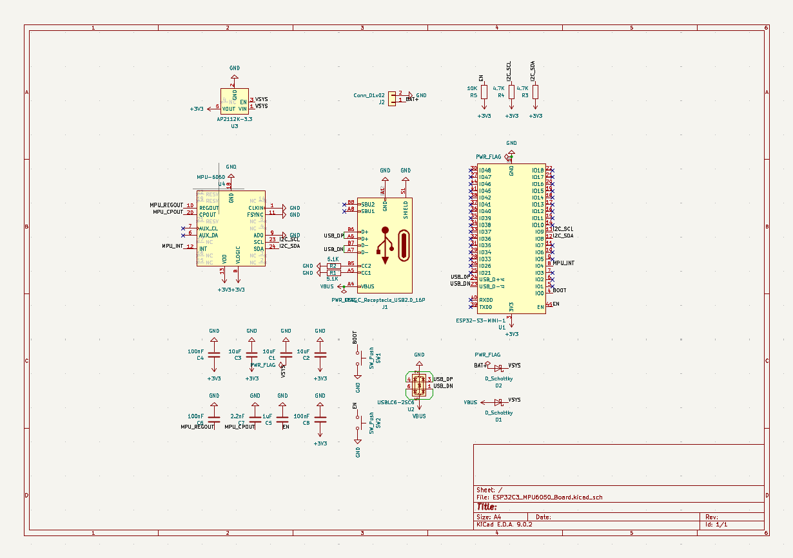

# ESP32-S3 + MPU-6050 Minimal Board

A small custom board built around the ESP32-S3-MINI-1 module and an MPU-6050 6-axis motion sensor, designed in KiCad. It is programmed over USB Type-C and runs from either USB or an external 3.7 V LiPo battery. Only the components needed for these functions are included.



## Features

- ESP32-S3-MINI-1 module with native USB, so no USB-to-serial chip is needed
- Programming over USB Type-C (hold BOOT, tap RESET)
- Power from USB Type-C (5 V) or an external 3.7 V LiPo battery
- MPU-6050 accelerometer and gyroscope on I2C
- USB ESD protection (USBLC6-2SC6)
- 2-layer PCB, about [22 x 30 ] mm, with parts on both sides

## Schematic



Full schematic: [docs/schematic.pdf](docs/schematic.pdf)

### Power

USB VBUS and the battery each pass through a Schottky diode (D1, D2) onto a shared VSYS rail. Whichever source is higher powers the board, and D1 stops the battery from feeding back into the USB port. An AP2112K-3.3 LDO (U3) produces the 3.3 V rail.

### Pin map

| Signal | ESP32-S3 pin | Connected to |
|---|---|---|
| USB D- | GPIO19 | USB-C via U2 |
| USB D+ | GPIO20 | USB-C via U2 |
| I2C SDA | GPIO8 | MPU-6050 SDA (4.7k pull-up) |
| I2C SCL | GPIO9 | MPU-6050 SCL (4.7k pull-up) |
| MPU INT | GPIO4 | MPU-6050 INT |
| BOOT | GPIO0 | SW1 to GND |
| EN | EN | 10k pull-up, 1 uF to GND, SW2 to GND |

The MPU-6050 address pin (AD0) is tied to GND, so the I2C address is 0x68.

## Bill of materials

| Ref | Part | Qty |
|---|---|---|
| U1 | ESP32-S3-MINI-1 | 1 |
| U2 | USBLC6-2SC6 | 1 |
| U3 | AP2112K-3.3 | 1 |
| U4 | MPU-6050 (QFN-24) | 1 |
| J1 | USB Type-C receptacle (16-pin) | 1 |
| J2 | 2-pin battery connector | 1 |
| D1, D2 | B5819W Schottky diode (SOD-123) | 2 |
| SW1, SW2 | Tactile switch (BOOT, RESET) | 2 |
| R1, R2 | 5.1k (USB CC pull-downs) | 2 |
| R3, R4 | 4.7k (I2C pull-ups) | 2 |
| R5 | 10k (EN pull-up) | 1 |
| C1, C2, C3 | 10 uF | 3 |
| C4, C6, C8 | 100 nF | 3 |
| C5 | 1 uF | 1 |
| C7 | 2.2 nF | 1 |

The exported BOM is in [docs/bom.csv](docs/bom.csv).

## Repository layout

```
hardware/   KiCad project (schematic and PCB)
gerbers/    Fabrication files (Gerbers and drill files)
docs/       Schematic PDF, PCB images, BOM
```

## Opening the project

1. Install [KiCad](https://www.kicad.org/) 8 or later.
2. Open `hardware/<project name>.kicad_pro`.

## Programming

1. Connect the board to your computer over USB Type-C.
2. Hold the BOOT button, tap RESET, then release BOOT. The board appears as a USB device.
3. Upload your sketch from the Arduino IDE or PlatformIO, selecting an ESP32-S3 board with USB CDC enabled.

## First power-up checklist

1. With a multimeter, check that 3V3 is not shorted to GND.
2. Connect USB and confirm the 3.3 V rail reads about 3.3 V.
3. Enter boot mode and flash a test sketch.
4. Run an I2C scanner. The MPU-6050 should appear at address 0x68.

## Known limitations

- There is no battery charger on the board. Use a protected 3.7 V LiPo and charge it externally.
- With a nearly empty battery, the diode drop and the LDO dropout reduce the usable voltage range.
- The MPU-6050 is not recommended for new designs. The MPU-6500 or ICM-42688-P can replace it with a footprint change.
- The antenna end of the module sits at the board edge. Keep metal and enclosures away from it.

## License

Released under the MIT License. See [LICENSE](LICENSE).
